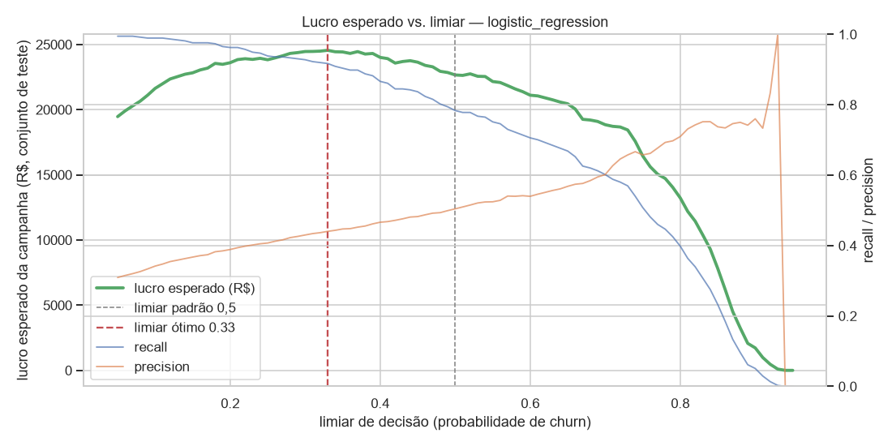
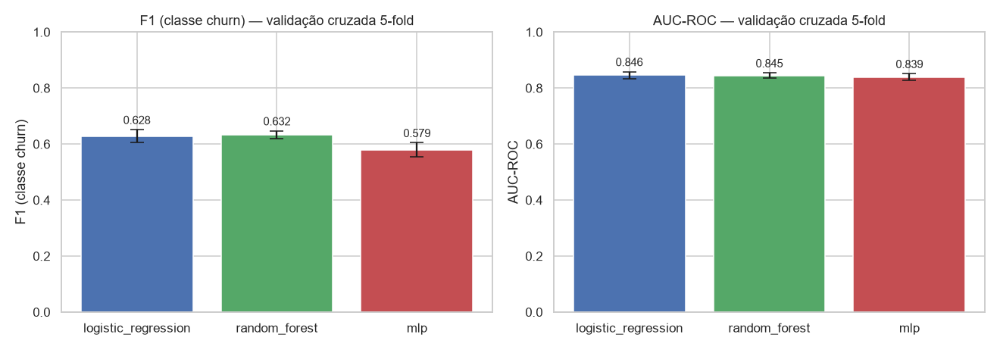

# ML Churn Alert

**Serviço de predição de churn para telecom, do notebook à API.**
Recebe o cadastro e o contrato de um cliente e devolve a probabilidade de cancelamento, a faixa de risco e a
ação sugerida para o time de retenção.




*O corte padrão de 50% não sabe nada do negócio. Ajustando o limiar pelo lucro esperado da campanha de retenção,
o modelo passa a encontrar 92% dos clientes que vão cancelar.*

---

## O problema

Uma operadora de telecomunicações está perdendo clientes. Dar desconto para toda a base é caro; não fazer nada é
mais caro ainda. A pergunta que o modelo responde, para cada cliente ativo: **vale abordar este cliente com uma
ação de retenção neste mês?**

## O que o serviço entrega

```json
POST /predict
{
  "churn_probability": 0.893,
  "churn_label": 1,
  "risk_tier": "alto",
  "suggested_action": "Contato proativo do time de retenção com oferta personalizada.",
  "threshold": 0.33
}
```

A resposta é uma decisão, não só um número. As faixas de risco separam bem os clientes no conjunto de teste:

| Faixa | Critério | % dos clientes | Churn real |
|---|---|---|---|
| baixo | p < 0,33 | 44,7% | 4,9% |
| medio | 0,33 ≤ p < 0,60 | 20,6% | 27,2% |
| alto | p ≥ 0,60 | 34,7% | 54,0% |

## Resultados

Três famílias de modelo comparadas com o mesmo pré-processamento e a mesma validação cruzada estratificada (5 folds):

| Modelo | F1 (CV) | AUC-ROC (CV) | F1 (teste) | Tempo de treino |
|---|---|---|---|---|
| **Regressão Logística ★** | 0,628 ± 0,023 | 0,846 ± 0,012 | 0,614 | 0,08 s |
| Random Forest | 0,632 ± 0,014 | 0,845 ± 0,009 | 0,634 | 1,73 s |
| MLP | 0,579 ± 0,026 | 0,839 ± 0,012 | 0,553 | 0,61 s |

- A regra de escolha foi definida **antes** de ver os números: maior F1 em validação cruzada; empate técnico (< 0,005)
  vai para o modelo mais simples. Random Forest e Regressão Logística empataram; ficou a Regressão Logística.
- O **limiar de decisão** foi ajustado pelo lucro esperado de uma campanha de retenção (premissas em
  `models/champion.json` e no [ML Canvas](docs/ml_canvas.md)): limiar 0,33, recall 0,92, +8% de lucro esperado.
- Detalhes, vieses e limitações no [Model Card](docs/model_card.md). Histórico em [experimentos.md](docs/experimentos.md).



## Arquitetura

```
notebooks/            experimentação (EDA, comparação de modelos)       ─┐
                                                                          │ importam
src/churn_alert/      código produtivo                                   ◄┘
├── config.py         seed, caminhos, lista de features
├── data.py           carga, limpeza, split estratificado
├── features.py       ColumnTransformer + Pipeline (pré-processamento dentro do modelo)
├── train.py          candidatos, validação cruzada, escolha do campeão, salvamento
├── threshold.py      limiar de decisão por custo de negócio
├── evaluate.py       métricas
├── predict.py        Predictor: carrega artefato + metadados, faixas de risco
├── schemas.py        contrato Pydantic da API
└── api.py            FastAPI: /health, /model, /predict, /predict/batch

models/champion.joblib   pipeline completo (pré-processamento + modelo)
models/champion.json     metadados: métricas, limiar, premissas de custo, features
```

Princípios: notebooks exploram, `src/` produz; pré-processamento vive **dentro** do artefato salvo, então a API
carrega um único objeto e chama `predict_proba`; seed 42 em todo passo aleatório.

## Setup

Requer Python 3.11+.

```bash
git clone https://github.com/Kaaaioh/ML-churn-alert.git
cd ML-churn-alert
python -m venv .venv
.venv\Scripts\activate            # Windows   |   Linux/macOS: source .venv/bin/activate
pip install -e ".[dev]"           # projeto + testes + notebooks   (só execução: pip install -r requirements.txt)
```

Dataset (público, IBM):

```bash
curl -L -o data/raw/telco_customer_churn.csv https://raw.githubusercontent.com/IBM/telco-customer-churn-on-icp4d/master/data/Telco-Customer-Churn.csv
```

## Como rodar

**1. Gerar o modelo** (os notebooks treinam, comparam e salvam o campeão):

```bash
jupyter nbconvert --to notebook --execute notebooks/01_eda_baseline.ipynb --inplace
jupyter nbconvert --to notebook --execute notebooks/02_modelos.ipynb --inplace
```

**2. Subir a API:**

```bash
uvicorn churn_alert.api:app --reload
```

Documentação interativa em http://127.0.0.1:8000/docs.

**3. Chamar:**

```bash
curl -X POST http://127.0.0.1:8000/predict -H "Content-Type: application/json" -d '{
  "gender": "Female", "SeniorCitizen": 0, "Partner": "No", "Dependents": "No", "tenure": 2,
  "PhoneService": "Yes", "MultipleLines": "No", "InternetService": "Fiber optic",
  "OnlineSecurity": "No", "OnlineBackup": "No", "DeviceProtection": "No", "TechSupport": "No",
  "StreamingTV": "Yes", "StreamingMovies": "Yes", "Contract": "Month-to-month",
  "PaperlessBilling": "Yes", "PaymentMethod": "Electronic check",
  "MonthlyCharges": 95.7, "TotalCharges": 191.4
}'
```

| Método | Rota | O que faz |
|---|---|---|
| GET | `/health` | Status da API e se o modelo está carregado |
| GET | `/model` | Metadados do campeão: nome, limiar, métricas, features |
| POST | `/predict` | Predição para um cliente |
| POST | `/predict/batch` | Predição para até 1.000 clientes |

Entrada validada com Pydantic: categoria fora do domínio ou número negativo retorna `422` com a explicação.
O caminho do artefato pode ser trocado pela variável de ambiente `CHURN_ALERT_MODEL_PATH`.

**4. Testes e lint:**

```bash
pytest -q          # 30 testes; treinam um modelo pequeno em pasta temporária, não dependem do artefato real
ruff check src tests
```

## Estrutura do repositório

```
├── data/raw/           dataset original (fora do git)
├── docs/               ML Canvas, Model Card, experimentos, roteiro do vídeo, figuras
├── models/             champion.joblib + champion.json (fora do git; gerados pelos notebooks)
├── notebooks/          01_eda_baseline, 02_modelos
├── src/churn_alert/    código produtivo
├── tests/              pytest
├── .github/workflows/  CI: lint + testes a cada push
├── pyproject.toml      dependências e configuração (ruff, pytest)
└── requirements.txt    dependências de execução, versões fixas
```

## Limitações conhecidas

- Dataset pequeno, público e estático; sem histórico temporal nem dados de atendimento.
- Probabilidades superestimadas pelo balanceamento de classes: servem para ranking e faixas, não como frequência
  real. Calibração é o próximo passo.
- O modelo não detecta churn em contratos de 2 anos e alerta a maioria dos idosos (que cancelam mais).
  Detalhes e recomendações no [Model Card](docs/model_card.md).
- Premissas de custo são hipotéticas; o limiar é recalculado automaticamente ao alterá-las.

## Contexto acadêmico

Projeto desenvolvido como Tech Challenge da Fase 1 da Pós-Tech em Machine Learning Engineering (FIAP),
cobrindo as disciplinas de Ciclo de Vida de Projetos de ML, Fundamentos de Modelos de ML, Engenharia de
Software para ML e APIs para Inferência. Roteiro da apresentação em [docs/roteiro_video_star.md](docs/roteiro_video_star.md).

## Autor

Kaio Henrique
